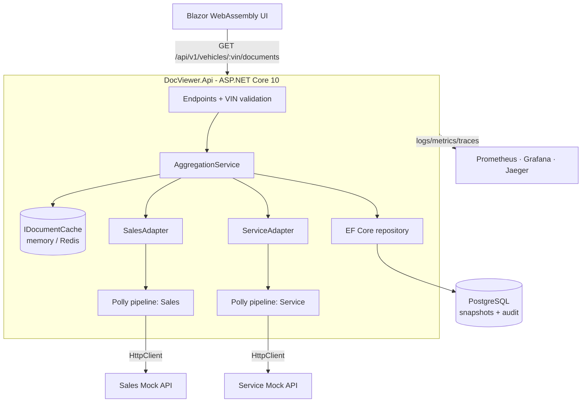
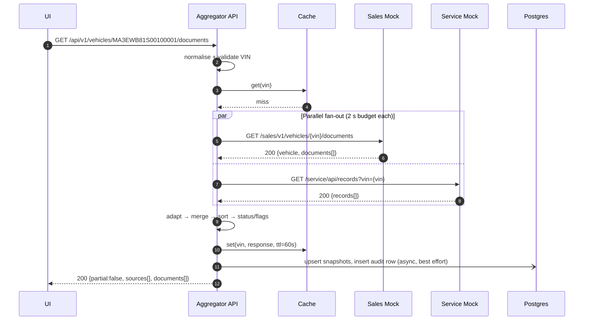

# Unified Document Viewer — System Design Document

> Keyloop Technical Assessment · **Scenario D (Domain: Operate)**
> Author: Kumar Abhik · Version 1.0 (submission) · Last updated: 2026-10-28
>
> Companion docs: [ROADMAP.md](ROADMAP.md) (progress) · [SYSTEMS.md](SYSTEMS.md) (decisions & errors log) · [AGENTS.md](AGENTS.md) (rules for AI agents)

---

## Table of Contents

1. [Problem Statement](#1-problem-statement)
2. [Goals, Non-Goals and Scope](#2-goals-non-goals-and-scope)
3. [Assumptions](#3-assumptions)
4. [Architecture](#4-architecture)
5. [Components and Responsibilities](#5-components-and-responsibilities)
6. [Data Flow](#6-data-flow)
7. [API Contract](#7-api-contract)
8. [Data Model](#8-data-model)
9. [Business Rules](#9-business-rules)
10. [Resilience Design](#10-resilience-design)
11. [Caching Strategy](#11-caching-strategy)
12. [Observability](#12-observability)
13. [Security and Privacy](#13-security-and-privacy)
14. [Technology Choices](#14-technology-choices)
15. [Building for the Future](#15-building-for-the-future)
16. [Testing Strategy](#16-testing-strategy)
17. [Local Development and Deployment](#17-local-development-and-deployment)
18. [Risks, Trade-offs and Future Work](#18-risks-trade-offs-and-future-work)
19. [How GenAI Was Used in the Design Phase](#19-how-genai-was-used-in-the-design-phase)
20. [Appendix A — Seed Data Matrix](#appendix-a--seed-data-matrix)
21. [Appendix B — Source Payload Examples](#appendix-b--source-payload-examples)

---

## 1. Problem Statement

A vehicle's paperwork is split across two dealership systems:

- **Sales System** — invoices, registration certificates (RC), insurance policies, warranty cards.
- **Service System** — job cards, service history entries, pollution-under-control (PUC) certificates, warranty claims.

Staff who need a car's full history must log into both systems, search each, and mentally merge the results. This is slow and error-prone (missed expiring insurance, duplicate paperwork, inconsistent dates).

**Goal:** one VIN search. The backend calls both systems **in parallel**, normalises their different formats into one document shape, merges them, and returns a single consolidated list in which **every document clearly shows its source system**. When one system is down, the user still sees what is available, with a clear warning.

## 2. Goals, Non-Goals and Scope

### 2.1 Functional goals (mapped to the brief)

| # | Requirement (brief) | How it is met |
|---|---|---|
| R1 | **Unified Search** — single interface to enter a VIN | `GET /api/v1/vehicles/{vin}/documents` + Blazor WebAssembly search page (D-025) |
| R2 | **Data Aggregation** — backend makes *parallel* requests to two mocked APIs | `Task.WhenAll` fan-out over two source adapters, each behind its own Polly resilience pipeline |
| R3 | **Aggregated View** — single consolidated list, source shown per document | Merged, sorted `documents[]`, each with `source`; UI renders source badges |

### 2.2 Quality goals

| Attribute | Target |
|---|---|
| Latency | p95 < 300 ms on cache miss with healthy sources (mock latency 50–150 ms); p95 < 20 ms on cache hit |
| Worst case | Response always returned within ~2.2 s even if a source hangs |
| Availability | One source down ⇒ still HTTP 200 with partial results; both down ⇒ stale data if available, else 503 |
| Correctness | Deterministic ordering; no silent data loss (dropped records are counted and logged) |
| Observability | Every request traceable end-to-end by one trace ID; RED metrics per source |

### 2.3 Layer choice (Part 2 of the brief)

**Backend is the fully implemented layer.** It is where the scenario's hard problems live: parallel fan-out, normalisation, partial failure, caching, persistence and observability.

The frontend is delivered as a **thin demo client** (Blazor WebAssembly, D-025) that consumes the real API, with a built-in mock mode so it can also run alone. It is deliberately simple and is not the graded layer. The OpenAPI spec and cURL examples are the formal client contract.

### 2.4 Non-goals

- Storing or rendering document **files** (PDF/images). Documents are metadata records.
- Writing back to source systems.
- Authentication and authorisation (designed for, not built; see §13).
- Search by anything other than VIN (registration number, customer name).

## 3. Assumptions

The brief is ambiguous in places. These are the assumptions made; each is also recorded in [SYSTEMS.md](SYSTEMS.md).

| ID | Assumption | Rationale |
|---|---|---|
| A1 | Documents are **metadata records** (id, type, dates, reference no.), not file contents. | The brief asks for a list view; file storage is a separate concern. |
| A2 | VIN is the only search key, **17 characters, A–Z and 0–9 excluding I, O, Q**, case-insensitive (normalised to upper case). | ISO 3779. |
| A3 | The VIN **check digit (position 9) is not enforced.** | It is mandatory only in North America; Indian-market VINs (e.g. `MA3…` Maruti Suzuki) often fail it. Enforcing it would reject real vehicles. |
| A4 | The same physical document may exist in both systems. It is **shown once per source** and flagged `POSSIBLE_DUPLICATE`, not silently merged. | Hiding a record from one system loses provenance; staff can judge. |
| A5 | A **2-second per-source budget** is acceptable to users. | Typical dealer-system latency is well under 1 s; 2 s caps the worst case. |
| A6 | Both source systems are owned by other teams and are **read-only** to us; they can be slow, flaky, or return malformed records. | Realistic integration assumption; drives the resilience design. |
| A7 | Data can be up to **60 seconds stale** on a cache hit, and up to **24 hours stale** when served as a fallback while a source is down (clearly labelled). | Documents change rarely; availability beats freshness here. |
| A8 | Authentication is out of scope for the assessment. | Listed as future work with a concrete design (§13). |
| A9 | A VIN with **no documents in either system** returns **200 with an empty list**, not 404. | The collection exists but is empty; 404 would also be ambiguous with a wrong URL. See D-004. |
| A10 | Date-only fields are calendar dates in dealership local time (IST); expiry is evaluated against "today" in that zone. | Avoids off-by-one expiry around midnight UTC. |

## 4. Architecture

### 4.1 Context diagram

```
                         ┌────────────────────────────────┐
  Dealership staff ────▶ │  Unified Document Viewer (UI)  │
                         └───────────────┬────────────────┘
                                         │ HTTPS / JSON
                         ┌───────────────▼────────────────┐
                         │      Document Aggregator API    │
                         └───────┬────────────────┬────────┘
                                 │                │
                     ┌───────────▼───┐      ┌─────▼──────────┐
                     │ Sales System  │      │ Service System │   (external, mocked)
                     └───────────────┘      └────────────────┘
```

### 4.2 Container / component diagram

```
┌──────────────────────────────┐
│  Blazor WebAssembly UI (C#)  │  search · results table · source badges
│  typed client · mock mode    │  partial/stale banners · health panel
└──────────────┬───────────────┘
               │ GET /api/v1/vehicles/{vin}/documents   (traceparent header)
┌──────────────▼──────────────────────────────────────────────────────────┐
│  DocViewer.Api — ASP.NET Core 10 Minimal API (stateless)                │
│                                                                         │
│  ┌────────────┐  ┌──────────────┐  ┌──────────────────────────────────┐ │
│  │ Endpoints  │─▶│ Vin (domain) │─▶│ AggregationService (Application) │ │
│  │ /api/v1    │  └──────────────┘  │  1 cache lookup                  │ │
│  └────────────┘                    │  2 parallel fan-out (WhenAll)    │ │
│                                    │  3 normalise → merge → sort      │ │
│  ┌────────────────────────────┐    │  4 status / dedupe / conflict    │ │
│  │ Middleware: ProblemDetails,│    │  5 stale fallback on failure     │ │
│  │ Serilog request log, OTel  │    │  6 persist snapshot + audit      │ │
│  └────────────────────────────┘    └───┬──────────┬──────────┬────────┘ │
│                                        │          │          │          │
│  ┌─────────────────────────────────────▼─┐  ┌─────▼───────┐  │          │
│  │ IHttpClientFactory typed clients      │  │IDocumentCache│ │          │
│  │ + Polly pipeline per source:          │  │ IDistributed │ │          │
│  │   total timeout · retry · breaker ·   │  │ Cache: memory│ │          │
│  │   attempt timeout                     │  │ or Redis     │ │          │
│  └───────┬─────────────────┬─────────────┘  └─────┬───────┘  │          │
│  ┌───────▼──────┐  ┌───────▼───────┐              │   ┌──────▼───────┐  │
│  │ SalesAdapter │  │ServiceAdapter │              │   │ EF Core      │  │
│  └───────┬──────┘  └───────┬───────┘              │   │ repository   │  │
└──────────┼─────────────────┼──────────────────────┼───┴──────┬───────┴──┘
           │ HTTP            │ HTTP                 │          │
   ┌───────▼──────┐  ┌───────▼───────┐        ┌─────▼────┐ ┌───▼────────┐
   │ Sales Mock   │  │ Service Mock  │        │  Redis   │ │ PostgreSQL │
   │ (ASP.NET)    │  │ (ASP.NET)     │        │(optional)│ │ snapshots, │
   │ camelCase    │  │ snake_case,   │        └──────────┘ │ audit log  │
   │ ISO dates    │  │ dd/MM/yyyy    │                     └────────────┘
   │ fault switch │  │ fault switch  │
   └──────────────┘  └───────────────┘

 Observability:  Serilog compact JSON → stdout
                 OpenTelemetry metrics → /metrics (Prometheus) → Grafana
                 OpenTelemetry traces → OTLP → Jaeger  (one trace across UI → API → mocks)
```

### 4.3 Mermaid version (renders on GitHub)



### 4.4 Architectural style

- **Clean Architecture / ports and adapters.** Four projects with one-way dependencies: `Api → Application → Domain`, and `Infrastructure → Application → Domain`. The aggregation core (Application) depends only on interfaces it owns: `ISourceAdapter`, `IDocumentCache`, `ISnapshotRepository`, `ISearchAuditWriter`. Each source system's quirks are confined to one adapter class in Infrastructure. Adding a third system (e.g. Parts or Finance) means writing one adapter and registering it in DI; the core does not change. Project references enforce the direction at compile time.
- **Stateless API.** All shared state lives in Redis and Postgres, so the API scales horizontally behind a load balancer.
- **Fail-soft aggregation.** A source failure is data (`sources[].status`), not an exception that aborts the request.

## 5. Components and Responsibilities

| Component | Responsibility | Must NOT do |
|---|---|---|
| **Blazor UI** (`frontend/DocViewer.Web`) | Capture and pre-validate the VIN (with `DocViewer.Domain`'s `Vin.TryParse`), call the API, render loading, empty, partial, stale and error states; show a source badge per document; filter by source/type/status. | Contain business rules (status, dedupe) — those are server-side. |
| **Endpoints** (`DocViewer.Api`, Minimal API route group `/api/v1`) | HTTP concerns: route/query binding, `TypedResults`, mapping domain errors to RFC 7807 `ProblemDetails`. | Contain aggregation logic. |
| **`Vin` value object** (`DocViewer.Domain`) | Normalise (trim, upper case) and validate the VIN format; `Vin.TryParse` returns a specific error. | Call external systems. |
| **AggregationService** (`DocViewer.Application`) | Orchestrates one search: cache → fan-out → normalise → merge/sort → enrich (status, flags) → fallback → persist → respond. | Know any source-specific field names. |
| **Source adapters** (`SalesAdapter`, `ServiceAdapter`, Infrastructure) | Call one source through its typed `HttpClient`, translate its payload into canonical `Document`s, skip-and-count malformed records, and convert every failure into a `SourceResult` (ok / timeout / error / circuit_open). Never throw. | Cache, or decide partial semantics. |
| **Resilience pipeline** (Polly v8 via `Microsoft.Extensions.Http.Resilience`) | Per-source total timeout, one bounded retry, circuit breaker, per-attempt timeout — configured on each named `HttpClient`. | Transform data. |
| **`IDocumentCache`** | Get/set of complete responses keyed by VIN with TTL over `IDistributedCache`: in-memory by default, Redis when `ConnectionStrings:Redis` is set. | Store partial or failed results. |
| **Repository** (EF Core + PostgreSQL) | Persist the **last-known-good snapshot** per (VIN, source) for stale fallback, and a **search audit log** (when/outcome/latency). | Become a source of truth for documents. |
| **Sales Mock API** (`SalesSystem.Mock`) | Simulates the Sales System with its own JSON shape, seeded data and a fault switch (delay, error, timeout, malformed). | — |
| **Service Mock API** (`ServiceSystem.Mock`) | Same for the Service System with a deliberately different shape (snake_case, `dd/MM/yyyy` dates, different type codes). | — |
| **Observability stack** | Prometheus scrapes `/metrics`; Grafana dashboard; Jaeger for traces. Optional in `docker compose --profile obs`. | — |

## 6. Data Flow

### 6.1 Happy path (cache miss, both sources healthy)



### 6.2 Step by step

1. **Input** — The user enters a VIN. The UI trims and upper-cases it, pre-validates the format, and calls the API with a `traceparent` header.
2. **Validate** — The API re-validates (the server is the authority). Invalid ⇒ `400` problem response; no downstream calls.
3. **Cache** — Look up `docs:v1:{VIN}`. Hit ⇒ return immediately with `cache: "HIT"` in the response meta and `X-Cache: HIT` header.
4. **Fan-out** — On a miss, start both adapter calls and await them with `Task.WhenAll`. Each call goes through its source's Polly pipeline (total timeout 2 s, one retry on fast transient failure, circuit breaker).
5. **Normalise** — Each adapter maps its payload to canonical `Document`s. Malformed records are skipped, counted (`adapter_records_dropped_total`) and logged with the record id — never fatal.
6. **Merge & enrich** — Concatenate, compute `status` (VALID / EXPIRING_SOON / EXPIRED / NOT_APPLICABLE), detect duplicates and conflicts across sources, and sort deterministically.
7. **Fallback** — For any failed source, load its last-known-good snapshot (≤ 24 h) from Postgres. If found, include those documents and mark the source `stale` with `asOf`.
8. **Respond** — Build the response with `partial` and per-source status/latency/count.
9. **Persist & cache** — If every source succeeded live, cache the response (60 s) and upsert snapshots. Always write one audit row. Persistence is fire-and-forget with a short timeout; a database outage must not fail the search.
10. **Render** — The UI shows the merged list with source badges and, if `partial`, a banner naming the failed or stale system.

### 6.3 Failure-path matrix

| Sales | Service | Snapshot available? | HTTP | `partial` | Body |
|---|---|---|---|---|---|
| ok | ok | – | 200 | false | All documents (may be empty) |
| ok | timeout/error/open | yes | 200 | true | Sales live + Service stale (`status:"stale"`, `asOf`) |
| ok | timeout/error/open | no | 200 | true | Sales only; Service `status:"timeout"` etc. |
| fail | fail | yes (either) | 200 | true | Stale data for failed sources, clearly labelled |
| fail | fail | no | 503 | – | Problem response listing both source failures, `Retry-After: 5` |
| – | – | – (invalid VIN) | 400 | – | Problem response, no downstream calls |

## 7. API Contract

The OpenAPI spec is generated by ASP.NET Core's built-in `Microsoft.AspNetCore.OpenApi` and written to [`docs/openapi.json`](docs/openapi.json) **at build time** (`Microsoft.Extensions.ApiDescription.Server`), so the committed contract cannot silently drift from the code. Served at `/openapi/v1.json`; interactive UI (Scalar) at `/scalar` in Development.

### 7.1 Endpoints

| Method | Path | Purpose |
|---|---|---|
| GET | `/api/v1/vehicles/{vin}/documents` | Aggregated documents for a VIN |
| GET | `/api/v1/sources/health` | Per-source circuit state and last latency (for the UI health panel) |
| GET | `/healthz` | Liveness — process is up |
| GET | `/readyz` | Readiness — `Healthy` (200) when the DB is reachable; `Degraded` (still 200) when it is not, because searches work without it (D-024); the database check gives up after 1 s so the 3 s container probe never waits on it (E-012). The cache is optional and not checked. Also the Docker healthcheck: `dotnet DocViewer.Api.dll --healthcheck` probes it from inside the container (D-023) |
| GET | `/metrics` | Prometheus metrics |

The spec states the canonical input (VIN pattern `^[A-HJ-NPR-Z0-9]{17}$`; filter values as enums). The API is deliberately more lenient: lower case, surrounding spaces, comma lists and empty filter values are accepted (D-021, D-026). Fields serialised only when not null (e.g. `sources[].error`) are not `required` in the schema (E-016).

**Query parameters** on the documents endpoint (all optional, applied after merge):

| Param | Example | Meaning |
|---|---|---|
| `source` | `SALES` | Only documents from this source (repeatable) |
| `type` | `INSURANCE` | Only this document type (repeatable) |
| `status` | `EXPIRED` | Only this computed status (repeatable) |
| `refresh` | `true` | Bypass the cache read (still writes) |
| `limit` | `20` | Optional page size, 1–100. Without it the whole list is returned (D-031) |
| `cursor` | `djF8…` | `nextCursor` of the previous page, unchanged; use the same filters and `limit` (D-031) |

### 7.2 Success response

```json
{
  "vin": "MA3EWB81S00100001",
  "partial": true,
  "generatedAt": "2026-10-27T09:12:44Z",
  "cache": "MISS",
  "traceId": "4bf92f3577b34da6a3ce929d0e0e4736",
  "sources": [
    { "name": "SALES",   "status": "ok",    "latencyMs": 118, "count": 4, "asOf": null },
    { "name": "SERVICE", "status": "stale", "latencyMs": 2001, "count": 3,
      "asOf": "2026-10-27T07:40:02Z", "error": "timeout" }
  ],
  "summary": { "total": 7, "expired": 1, "expiringSoon": 1, "duplicates": 0, "conflicts": 0 },
  "documents": [
    {
      "id": "SALES:INV-2025-0091",
      "sourceId": "INV-2025-0091",
      "vin": "MA3EWB81S00100001",
      "title": "Sales Invoice",
      "type": "INVOICE",
      "date": "2025-03-14",
      "expiryDate": null,
      "source": "SALES",
      "status": "NOT_APPLICABLE",
      "flags": [],
      "metadata": { "dealer": "Nexa Koramangala", "amount": "845000.00", "currency": "INR" }
    }
  ]
}
```

`sources[].status` ∈ `ok | stale | timeout | error | circuit_open`.
`partial` is `true` whenever any source status is not `ok`.

Details settled during implementation (D-021):

- `summary` counts every document that matches the filters, on all pages together (D-031). Without `limit` that is exactly the documents in the response, so `summary.total == documents.length` as before (D-021).
- `nextCursor` is always present: `null` on the last page and whenever `limit` is not set. It is opaque keyset position (date, source, sourceId) in the D-012 order, so a document added between two requests never makes a later page repeat or skip one. A bad `limit` or `cursor` ⇒ 400 `invalid-page`, before any source is called.
- A stale source keeps its original `error` (why it is stale) next to `asOf`.
- Filters accept the wire names case-insensitively, repeated or comma-separated (`?type=PUC,INSURANCE`); unknown or numeric values ⇒ 400 `invalid-filter`.
- Enum spelling: source and circuit states lower snake case (`circuit_open`, `half_open`); all other enums upper snake case (`EXPIRING_SOON`, `SALES`).
- Headers on every response: `X-Trace-Id`; on 200: `X-Cache: HIT | MISS | BYPASS`; on 503: `Retry-After: 5`.
- The 503 problem body has a `sources` extension: `[{ "name": "SALES", "status": "error", "error": "http_500" }, …]`.

### 7.3 Error responses (RFC 7807 `application/problem+json`)

```json
{
  "type": "https://docviewer.local/problems/invalid-vin",
  "title": "Invalid VIN",
  "status": 400,
  "detail": "VIN must be 17 characters (A–Z, 0–9, excluding I, O, Q). Got 16 characters.",
  "instance": "/api/v1/vehicles/MA3EWB81S0010000/documents",
  "traceId": "4bf92f3577b34da6a3ce929d0e0e4736"
}
```

| Status | When |
|---|---|
| 400 | Invalid VIN format or invalid filter value |
| 200 | Success — complete, partial, stale, or empty |
| 429 | More than `RateLimit:PermitsPerMinute` searches (default 60) from one client IP in a minute; `Retry-After` set; no source is called (R5) |
| 503 | Both sources failed and no snapshot exists (`Retry-After` set) |
| 500 | Unexpected bug (generic message; details only in logs) |

### 7.4 cURL examples

```bash
curl -s localhost:8080/api/v1/vehicles/MA3EWB81S00100001/documents | jq
curl -s "localhost:8080/api/v1/vehicles/MA3EWB81S00100005/documents?status=EXPIRED" | jq
curl -s -i localhost:8080/api/v1/vehicles/BADVIN/documents            # 400
curl -s -X POST localhost:8082/__admin/fault -H "Content-Type: application/json" \
     -d '{"mode":"timeout"}'                                            # break Service mock
curl -s localhost:8080/api/v1/vehicles/MA3EWB81S00100001/documents | jq .partial   # true
```

An `http/docviewer.http` file with the same requests is included for Visual Studio / VS Code REST Client / Rider.

### 7.5 Mock source contracts

| Mock | Endpoint | Shape |
|---|---|---|
| Sales (`:8081`) | `GET /sales/v1/vehicles/{vin}/documents` | `{ "vehicle": {...}, "documents": [ { "docId", "docType", "issuedOn" (ISO), "validUntil", "title", "meta": {...} } ] }`; 404 when VIN unknown |
| Service (`:8082`) | `GET /service/api/records?vin={vin}` | `{ "records": [ { "record_no", "category", "created" (dd/MM/yyyy), "expiry", "description", "workshop", "odometer_km" } ] }`; 200 with empty `records` when unknown |
| Both | `POST /__admin/fault` `{mode, delayMs, rate}` | Modes: `none`, `slow`, `timeout`, `error` (500), `flaky` (fails `rate` share), `malformed` |

The two mocks intentionally differ in naming, date format, type vocabulary and "not found" semantics (404 vs empty list), so the adapters do real translation work.

## 8. Data Model

### 8.1 Canonical `Document`

| Field | Type | Notes |
|---|---|---|
| `id` | string | `"{SOURCE}:{sourceId}"` — globally unique, stable |
| `sourceId` | string | ID in the originating system |
| `vin` | string | Normalised VIN |
| `title` | string | Human-readable title |
| `type` | enum `DocumentType` | `INVOICE, RC, INSURANCE, PUC, WARRANTY, JOB_CARD, SERVICE_HISTORY, OTHER` |
| `date` | date | Issue / creation date |
| `expiryDate` | date \| null | Only for expiring types |
| `source` | enum `SourceSystem` | `SALES, SERVICE` |
| `status` | enum `DocumentStatus` | Computed: `VALID, EXPIRING_SOON, EXPIRED, NOT_APPLICABLE` |
| `flags` | list of enum | `POSSIBLE_DUPLICATE, CONFLICT, STALE` (C# enum `DocumentMarker`; see E-002) |
| `metadata` | object | Source-specific extras, string values only |

### 8.2 Type mapping

| Canonical | Sales `docType` | Service `category` |
|---|---|---|
| INVOICE | `SALE_INVOICE` | `INV` |
| RC | `REG_CERT` | – |
| INSURANCE | `INSURANCE_POLICY` | – |
| PUC | – | `PUC` |
| WARRANTY | `WARRANTY_CARD` | `WTY_CLAIM` |
| JOB_CARD | – | `JC` |
| SERVICE_HISTORY | – | `SVC` |
| OTHER | anything else | anything else (logged as `unknown_type`) |

### 8.3 Persistence (EF Core 10 + PostgreSQL; SQLite for tests)

The brief requires a persistent database for the backend. Documents remain owned by the source systems; the aggregator persists only what it needs to be reliable and auditable.

```sql
-- Last-known-good payload per source, used as stale fallback (D-003)
CREATE TABLE source_snapshot (
  vin          CHAR(17)    NOT NULL,
  source       VARCHAR(16) NOT NULL,
  documents    JSONB       NOT NULL,      -- canonical documents
  fetched_at   TIMESTAMPTZ NOT NULL,
  PRIMARY KEY (vin, source)
);

-- One row per search, for auditing and offline analysis
CREATE TABLE search_audit (
  id            BIGSERIAL   PRIMARY KEY,
  trace_id      VARCHAR(32) NOT NULL,
  vin_hash      CHAR(64)    NOT NULL,     -- SHA-256(VIN + salt), never the raw VIN
  outcome       VARCHAR(16) NOT NULL,     -- complete | partial | failed | invalid
  cache_hit     BOOLEAN     NOT NULL,
  latency_ms    INTEGER     NOT NULL,
  source_status JSONB       NOT NULL,     -- {"SALES":"ok","SERVICE":"timeout"}
  doc_count     INTEGER     NOT NULL,
  created_at    TIMESTAMPTZ NOT NULL DEFAULT now()
);
CREATE INDEX ix_search_audit_created_at ON search_audit (created_at);
```

The SQL above is the logical schema. It is owned by an EF Core `DocViewerDbContext`; schema changes go through **EF Core migrations** (`dotnet ef migrations add …`), applied at startup in Development and by a migration step in Docker Compose. `documents` and `source_status` map to `jsonb` on PostgreSQL and `TEXT` on SQLite.

The provider is chosen by `Persistence:Provider` (D-019): **SQLite** by default so `dotnet run` needs no database server (schema via `EnsureCreated`), **PostgreSQL** in Docker (schema via the committed migrations). Snapshot age is checked in memory after a primary-key lookup, because SQLite cannot translate `DateTimeOffset` comparisons.

## 9. Business Rules

### 9.1 VIN validation

```
normalise: strip whitespace, upper-case
regex:     ^[A-HJ-NPR-Z0-9]{17}$
```
Error messages say *why* (length, which illegal character and at which position).

### 9.2 Document status

Evaluated against `today` from the injected .NET `TimeProvider`, converted to the dealership timezone (default `Asia/Kolkata`). Tests use `FakeTimeProvider`.

| Condition | Status |
|---|---|
| `expiryDate` is null | `NOT_APPLICABLE` |
| `expiryDate < today` | `EXPIRED` |
| `today ≤ expiryDate ≤ today + 30 days` | `EXPIRING_SOON` |
| otherwise | `VALID` |

The 30-day window is configurable (`EXPIRY_WARNING_DAYS`).

### 9.3 Sorting

`date` **descending**, then `source` ascending, then `sourceId` ascending. The tie-breakers make output deterministic, which keeps caching, tests and UI stable.

### 9.4 Duplicate and conflict detection (across sources only)

- **Match key:** `(type, normalised reference number)` where the reference is `meta.refNo` (Sales) or the `record_no` suffix (Service). Falls back to `(type, date)` for INVOICE/WARRANTY only.
- Two documents from **different sources** with the same key and the **same** `date`/`expiryDate` ⇒ both flagged `POSSIBLE_DUPLICATE`, `metadata.duplicateOf` points at the other `id`.
- Same key but **different** `date` or `expiryDate` ⇒ both flagged `CONFLICT`. Staff should check which system is wrong.
- Records are never deleted or merged (assumption A4).

### 9.5 Partial semantics

- `partial = any(source.status != "ok")`.
- A partial response is **never cached** (D-006). The next request retries the failed source.
- An empty result is only "complete" if both sources answered `ok`.

## 10. Resilience Design

Implemented with **Polly v8** through `Microsoft.Extensions.Http.Resilience` (`AddResilienceHandler`), one named pipeline per source client. Strategy order, outermost first:

```
Total timeout (2 s) → Retry (max 1) → Circuit breaker → Attempt timeout (1.5 s) → HttpClient
```

| Mechanism | Setting | Why |
|---|---|---|
| **Total timeout** | 2.0 s per source, including any retry | Caps worst-case latency; user-facing budget (A5, D-005) |
| **Attempt timeout** | 1.5 s per attempt; `SocketsHttpHandler.ConnectTimeout` 0.5 s | One slow attempt cannot use the whole budget |
| **Retry** | Max 1; only on `HttpRequestException` (connect failure) or 502 / 503 / 504; **not** on attempt timeout or open circuit; 100 ms jittered backoff. If the total timeout fires during the retry, the result is a timeout. | Absorbs blips without breaking the deadline (D-005) |
| **Circuit breaker** | Per source, per process. Opens when ≥ 50 % of calls fail within a 10 s window with at least 3 calls (D-027; was 5); stays open 30 s; half-open allows one probe | Stops hammering a dead system and saves 2 s for users while it is down (D-014) |
| **Stale fallback** | Snapshot ≤ 24 h from Postgres | Keeps the page useful during outages (D-003) |
| **Bulkhead** | One named `HttpClient` per source with its own `SocketsHttpHandler`, `MaxConnectionsPerServer = 50` | A slow source cannot exhaust connections for the other |
| **Graceful degradation of infra** | Redis down ⇒ skip cache. Postgres down ⇒ skip snapshot/audit. Both logged and counted. | Supporting infrastructure must never take search down |
| **Fail-fast validation** | Invalid VIN rejected before any I/O | Protects sources from junk traffic |

The adapter maps the outcome to a `SourceResult`: `TimeoutRejectedException` / `OperationCanceledException` from the pipeline ⇒ `timeout`; `BrokenCircuitException` ⇒ `circuit_open`; other HTTP or parse failures ⇒ `error`. Circuit state is observed through Polly's `CircuitBreakerStateProvider` for `/api/v1/sources/health`.

Circuit breaker states:

```
CLOSED --≥50% failures (min 5 calls / 10 s)--> OPEN --30 s--> HALF_OPEN --probe ok--> CLOSED
                                                 ^                 |
                                                 +---probe fails---+
```

## 11. Caching Strategy

| Aspect | Decision |
|---|---|
| What | Complete (non-partial) aggregated responses, **before** query filters are applied |
| Key | `docs:v1:{VIN}` (the version prefix allows invalidation on schema change) |
| TTL | 60 s (`CACHE_TTL_SECONDS`) |
| Backend | `IDistributedCache`: `AddDistributedMemoryCache` by default; `AddStackExchangeRedisCache` when `ConnectionStrings:Redis` is set (shared across replicas). Wrapped by `IDocumentCache`, which serialises with `System.Text.Json` |
| Bypass | `?refresh=true` |
| Stampede | Per-key `SemaphoreSlim` (single-flight) so concurrent misses for one VIN do a single fan-out per process |
| Why not `HybridCache` | It caches whatever the factory returns; it cannot decide *after* the call that a partial result must not be stored (D-015) |
| Not cached | Partial responses, 4xx/5xx |

## 12. Observability

### 12.1 Logging — Serilog, compact JSON to stdout

`Serilog.AspNetCore` with `CompactJsonFormatter`, `UseSerilogRequestLogging` for the access log, and enrichers for `TraceId`/`SpanId` from `Activity.Current`. Code logs through `ILogger<T>` using **source-generated `[LoggerMessage]` methods** (structured, allocation-free).

One **access log** line per request plus one line per **source call**. Standard fields:

| Field | Example |
|---|---|
| `ts`, `level`, `event` | `"search.completed"` |
| `trace_id`, `span_id` | correlate with Jaeger |
| `vin_masked` | `MA3**********0001` (WMI + last 4) |
| `outcome` | `complete` / `partial` / `failed` / `invalid` |
| `cache` | `HIT` / `MISS` / `BYPASS` |
| `latency_ms` | total |
| `sources` | `{"SALES":{"status":"ok","ms":118,"count":4},"SERVICE":{...}}` |
| `dropped_records` | per source, with reasons |

Raw VINs never appear in logs (§13). Two mechanisms enforce it (E-007): the access log records the route template (`/api/v1/vehicles/{vin}/documents`), and an enricher drops the `RequestPath` property that ASP.NET Core's per-request log scope would otherwise attach to every event.

### 12.2 Metrics — `System.Diagnostics.Metrics` + OpenTelemetry, exposed on `/metrics`

Custom instruments live on one `Meter("DocViewer")` in a `DocViewerMetrics` class (registered via `IMeterFactory`). OpenTelemetry collects them together with the built-in ASP.NET Core, HttpClient, runtime and **Polly resilience** meters, and exports them in Prometheus format on `/metrics`. Names below are the Prometheus-exported forms.

| Metric | Type | Labels | Question it answers |
|---|---|---|---|
| `http_server_request_duration_seconds` (built-in) | histogram | `http_route, http_response_status_code` | Traffic, error rate, end-to-end p50/p95/p99 |
| `docviewer_source_requests_total` | counter | `source, outcome` | Which source is failing, and how |
| `docviewer_source_duration_seconds` | histogram | `source` | p95 latency per source |
| `resilience_polly_strategy_events_total` (built-in) | counter | `pipeline_name, event_name` | Retries, timeouts, breaker opens — is retry masking a problem? |
| `docviewer_circuit_state` | observable gauge | `source` | 0 closed, 1 half-open, 2 open |
| `docviewer_cache_requests_total` | counter | `result` (hit/miss/bypass/error) | Cache hit rate |
| `docviewer_partial_responses_total` | counter | `failed_source` | User-visible degradation |
| `docviewer_stale_served_total` | counter | `source` | How often the fallback is used |
| `docviewer_adapter_records_dropped_total` | counter | `source, reason` | Data quality of sources |

### 12.3 Tracing — OpenTelemetry

- Instrumentation for ASP.NET Core, HttpClient and EF Core. .NET propagates W3C `traceparent` by default, **UI → API → both mocks**, so one trace shows the parallel fan-out as two sibling spans.
- Manual spans from `ActivitySource("DocViewer")`: `aggregate`, `cache.get`, `source.sales`, `source.service`, `merge`, `snapshot.persist`.
- Exporter: OTLP → Jaeger (compose profile `obs`) or the standalone **.NET Aspire dashboard** container (logs + traces + metrics in one UI); disabled in tests.
- The `traceId` is returned in the response body and the `X-Trace-Id` header, so a support ticket can quote it.
- **Redaction:** HTTP spans record URLs, which contain the VIN. A `VinRedactionProcessor` masks every standalone 17-character alphanumeric token (valid VIN or not) in span tags and names before export (D-022, E-007).

### 12.4 SLOs and alerts (proposed)

| SLO | Target | Alert |
|---|---|---|
| Availability (non-5xx) | 99.9 % / 30 days | Burn rate > 14× for 5 min |
| Latency | p95 < 500 ms | p95 > 1 s for 10 min |
| Degradation | partial responses < 5 % | > 20 % for 5 min, or any circuit open > 2 min |

Grafana dashboard JSON is committed under `infra/grafana/`.

## 13. Security and Privacy

- **VIN as personal data.** A VIN is linked to an owner, so it is treated as PII: masked in logs, hashed (salted SHA-256) in the audit table, and excluded from metric labels (which also prevents label-cardinality blow-up).
- **Input validation** at the edge with strict regex; filter params are validated enums.
- **No secrets in code**; configuration via `appsettings.json` + environment variables (`DocViewer__…`) bound to validated options classes (`ValidateDataAnnotations().ValidateOnStart()`); `dotnet user-secrets` for local secrets; `.env` git-ignored.
- **Error hygiene.** 500 responses carry a generic message plus `traceId`; stack traces only in logs.
- **CORS** restricted to the UI origin.
- **Future auth design.** OIDC (dealer SSO) → JWT bearer validated at the API; claims carry `dealer_id`; the aggregator passes dealer scope to sources so staff only see their dealership's vehicles; role `viewer` vs `admin` (admin may use `refresh`).
- **Rate limiting (future).** Per-user token bucket in Redis to protect source systems.

## 14. Technology Choices

| Area | Choice | Justification | Alternatives considered |
|---|---|---|---|
| Platform | **.NET 10 (LTS), C# 14** | Target role is .NET/C#; LTS until Nov 2028; first-class async, DI, config, logging and OpenTelemetry in the box (D-013) | Python/FastAPI (first plan — fast to build, but off-stack for the role); Go |
| API style | **ASP.NET Core Minimal APIs** with route groups and `TypedResults` | Little ceremony, fast, typed results feed OpenAPI accurately | MVC controllers — more boilerplate for 4 endpoints |
| Structure | **Clean Architecture**: Domain / Application / Infrastructure / Api projects | Compiler-enforced dependency direction; matches ports-and-adapters design | Single project with folders (direction not enforced) |
| HTTP client | **`IHttpClientFactory` typed clients** | Pooled handlers, DNS refresh, per-source configuration and bulkheads | `new HttpClient()` (socket exhaustion), Refit |
| Concurrency | **`Task.WhenAll`** over adapter calls that never throw | Simple, readable parallel fan-out | `Parallel.ForEachAsync` (meant for many items, not two calls) |
| Resilience | **Polly v8 via `Microsoft.Extensions.Http.Resilience`** | Industry standard in .NET; timeout, retry, breaker and telemetry built in; configured, not hand-written (D-014) | In-house breaker (the Python plan) — more code to own and test |
| Validation / models | **C# `record` types**, `System.Text.Json` (source-generated context), options validation | Immutable domain values; fast, trimming-safe JSON | Newtonsoft.Json |
| Database | **PostgreSQL 16** + **EF Core 10** (Npgsql) + migrations | Brief requires persistence; `jsonb` fits snapshots; EF migrations are standard | Dapper (fine, but migrations become manual) |
| Test DB | **SQLite in-memory** via EF Core | Zero-setup integration tests; same `DbContext` | Testcontainers PostgreSQL (CI job, Day 5) |
| Cache | **`IDistributedCache`** — memory default, **Redis 7** optional, behind `IDocumentCache` | Local runs need no Redis; Redis shares cache across replicas | `HybridCache` — cannot skip caching partial results (D-015) |
| Time | **`TimeProvider`** + `FakeTimeProvider` | Built-in abstraction; Polly and caches honour it too | Custom `IClock` |
| Logging | **Serilog** (compact JSON) + `[LoggerMessage]` source generators | Structured JSON, rich enrichers, widely used in .NET shops | Built-in JSON console logger |
| Metrics & tracing | **OpenTelemetry .NET** (ASP.NET Core, HttpClient, EF Core, runtime, Polly meters) → Prometheus `/metrics` + OTLP | Vendor-neutral, first-party support in .NET | prometheus-net only (no tracing) |
| API docs | **`Microsoft.AspNetCore.OpenApi`** (build-time `openapi.json`) + **Scalar** UI | Built in since .NET 9; spec is a build output so it never drifts | Swashbuckle (no longer in templates) |
| Tests | **xUnit**, **Shouldly**, **NSubstitute**, **WireMock.Net**, **`WebApplicationFactory`**, **coverlet** | Real HTTP fakes for timeouts/500s/malformed bodies; in-memory hosting of the full API | FluentAssertions — v8 moved to a commercial licence (D-016) |
| Quality | **Nullable reference types**, `TreatWarningsAsErrors`, .NET analyzers (`AnalysisLevel latest-recommended`), `dotnet format`, **Central Package Management** | Catches AI-introduced nullability and API-misuse errors at compile time | StyleCop (noisier) |
| Frontend (demo) | **Blazor WebAssembly** (.NET 10), typed `HttpClient`, in-process mock handler, **bUnit**; served by nginx in Docker | One language for the whole repo, no Node.js; shares the Domain VIN rules; mock mode runs the UI without the backend (D-025) | React + Vite + MSW (the original plan; a second language and toolchain for a demo client) |
| Packaging | **Docker Compose** (chiselled .NET runtime images) | One command starts API, mocks, Postgres, Redis (+ optional observability) | .NET Aspire AppHost (Day 5 stretch); Kubernetes |
| CI | **GitHub Actions** | Build (warnings as errors), format check, tests + coverage, OpenAPI drift check | – |

## 15. Building for the Future

| Concern | Design response |
|---|---|
| **Scalability** | Stateless API; shared cache in Redis; DB used only for small snapshot/audit writes off the hot path; horizontal scaling behind a load balancer. Fan-out cost is O(sources) per request, not O(users). |
| **Performance** | Parallel calls (latency ≈ the slowest source, not the sum); 60 s cache; single-flight on misses; pooled keep-alive connections per source; async persistence after the response is built. |
| **Reliability** | Deadlines, bounded retry, circuit breakers, stale fallback, bulkheads, and degraded operation when Redis or Postgres is down. |
| **Maintainability** | Clean Architecture with compiler-enforced references; one adapter per source; immutable records; nullable reference types and warnings-as-errors; ADR-style decision log in SYSTEMS.md; ≥ 85 % line coverage on Domain and Application. |
| **Extensibility** | New source = new adapter class + DI registration + `SourceSystem` enum value. No core changes. |
| **Observability** | Logs, metrics and traces correlated by `trace_id`; SLOs defined up front. |

## 16. Testing Strategy

| Level | Project | Scope | Tools | Examples |
|---|---|---|---|---|
| Unit — domain | `DocViewer.Domain.Tests` | VIN rules, status computation, sort, dedupe/conflict | xUnit, Shouldly, `FakeTimeProvider` | `TryParse_rejects_I_O_Q`, `Status_is_ExpiringSoon_on_day_30`, `Sort_is_deterministic` |
| Unit — application | `DocViewer.Application.Tests` | AggregationService with fake adapters/cache/repository | xUnit, NSubstitute / hand fakes | one source down ⇒ partial; both down ⇒ stale or `AllSourcesFailed`; partial not cached; calls run concurrently |
| Integration — adapters & resilience | `DocViewer.Infrastructure.Tests` | Payload mapping, malformed records, Polly pipeline against a real HTTP server | WireMock.Net (delays, 503s, bad JSON), `FakeTimeProvider` | `Service_adapter_parses_ddMMyyyy`, `Sales_404_means_empty`, `No_retry_after_attempt_timeout`, `Breaker_opens_then_half_opens` |
| Integration — persistence | `DocViewer.Infrastructure.Tests` | EF Core repository | SQLite in-memory | upsert overwrites; old snapshot ignored; DB failure swallowed |
| Integration — real PostgreSQL | `DocViewer.Infrastructure.Tests` (`Persistence/Postgres`) | Committed migrations and repositories on the production database | Testcontainers, `postgres:16-alpine` | migrations apply; JSON columns are `jsonb`; round-trips; `jsonb` re-formats JSON text (E-015) |
| API | `DocViewer.Api.Tests` | Full app in memory, sources faked over HTTP | `WebApplicationFactory`, WireMock.Net, SQLite | 400/200/503 contracts; `X-Cache: HIT` on second call; ProblemDetails shape |
| Mocks | `Mocks.Tests` | Seed scenarios and fault modes | `WebApplicationFactory` | `timeout` mode delays beyond 2 s; `malformed` returns bad JSON |
| Contract | CI | Committed `docs/openapi.json` equals the build output | `git diff --exit-code` | Spec drift fails the build |
| Contract fuzzing | CI (`contract-fuzz`) | Generated requests against the running stack, answers checked against `docs/openapi.json` | Schemathesis 4.31.1 (Docker), all checks except `negative_data_rejection` (D-026) | status codes, content types and response schemas conform; no 5xx |
| End-to-end | script | `docker compose up` + scripted cURL smoke test | PowerShell / bash | Fault toggle ⇒ `partial: true` |
| Load | `infra/k6` | 50 VUs, 2 min, mixed hit/miss | k6 (Day 5) | p95 within targets; breaker behaviour under failure |
| Frontend | `DocViewer.Web.Tests` | Components and the whole page against mock mode; DTOs vs `openapi.json` | bUnit, xUnit, `FakeTimeProvider` | partial/stale banners, badges per source, every state, URL filters, contract drift |

**Mandatory scenarios from the plan:** VIN validation, merge and sort, one source down, both down, timeout, cache hit — all automated.

## 17. Local Development and Deployment

```text
keyloop/
├── AGENTS.md  CLAUDE.md  DESIGN.md  ROADMAP.md  SYSTEMS.md  README.md
├── DocViewer.slnx                  # solution (XML .slnx format, .NET 10)
├── global.json                     # pins the .NET 10 SDK
├── Directory.Build.props           # nullable, warnings-as-errors, analyzers for every project
├── Directory.Packages.props        # Central Package Management (one place for versions)
├── src/
│   ├── DocViewer.Domain/           # pure: Vin, Document, enums, DocumentStatusCalculator, DocumentMerger
│   ├── DocViewer.Application/      # AggregationService, ports (ISourceAdapter, IDocumentCache, …), DTOs
│   ├── DocViewer.Infrastructure/   # SalesAdapter, ServiceAdapter, Polly config, cache, EF Core, migrations
│   └── DocViewer.Api/              # Program.cs, endpoints, ProblemDetails, Serilog, OpenTelemetry
├── mocks/
│   ├── Mocks.Common/               # fault-injection middleware + /__admin/fault endpoints
│   ├── SalesSystem.Mock/           # Program.cs + seed/sales.json
│   └── ServiceSystem.Mock/         # Program.cs + seed/service.json
├── tests/
│   ├── DocViewer.Domain.Tests/
│   ├── DocViewer.Application.Tests/
│   ├── DocViewer.Infrastructure.Tests/
│   ├── DocViewer.Api.Tests/
│   ├── Mocks.Tests/
│   └── DocViewer.Web.Tests/        # bUnit tests for the demo client
├── frontend/DocViewer.Web/         # Blazor WebAssembly demo client (D-025)
├── aspire/DocViewer.AppHost/       # optional one-command local run with the Aspire dashboard (D-030)
├── http/docviewer.http             # runnable request examples
├── docker/Dockerfile               # one multi-stage Dockerfile for the API and both mocks
├── scripts/coverage.ps1            # tests + coverage report + 85 % gate
├── infra/{prometheus,grafana,k6}/
├── docs/{openapi.json, diagrams/}
├── docker-compose.yml
└── .github/workflows/ci.yml
```

| Command | Effect |
|---|---|
| `docker compose up --build` | API :8080, Sales mock :8081, Service mock :8082, Postgres :5432, Redis :6379, UI :5173 (nginx) |
| `docker compose --profile obs up` | + Prometheus :9090, Grafana :3000, Jaeger :16686 |
| `dotnet run --project aspire/DocViewer.AppHost` | The same services through .NET Aspire, plus its dashboard (D-030) |
| `dotnet build` | Builds everything (warnings are errors) and regenerates `docs/openapi.json` |
| `dotnet test` | All test projects |
| `dotnet format --verify-no-changes` | Style check (CI) |
| `dotnet run --project src/DocViewer.Api` | Run the API locally (mocks via `dotnet run --project mocks/...`) |

All commands work the same on Windows, macOS and Linux; no `make` required.

## 18. Risks, Trade-offs and Future Work

| Risk / trade-off | Mitigation / note |
|---|---|
| Circuit breaker state is per process, so N replicas need N failures each to open | Acceptable at this scale; future: shared state in Redis |
| Duplicate detection is heuristic and may produce false positives | Flag-only, never hides data; key rules are unit-tested and easy to tune |
| Stale fallback can show outdated data | Labelled with `asOf`; capped at 24 h |
| Two mocks are under our control, so they may be friendlier than real systems | Fault modes include malformed payloads and flakiness |
| Scope creep in a 5-day timebox | Strict roadmap; Days 4–5 are explicitly optional extras |

**Future work:** document file preview via signed URLs; OIDC auth and dealer scoping; pagination for vehicles with very long histories; async refresh via a message queue for slow sources (return cached, refresh in background); shared circuit state; Helm chart; more sources (Parts, Finance, OEM recall feeds) as new adapters.

## 19. How GenAI Was Used in the Design Phase

> This section is required by the brief. Keep it honest and specific. The running evidence log is the **AI Corrections Log** in [SYSTEMS.md](SYSTEMS.md#4-ai-corrections-log).

**Tools.** An AI chat assistant for the first-pass plan, and Claude Code (agentic, in VS Code) for review, documentation and implementation, steered by [AGENTS.md](AGENTS.md).

**Re-platforming with AI.** The first design and scaffold were Python/FastAPI, chosen by the agent from my GitHub history. I redirected it to .NET 10 / C# because the target role is .NET (D-013, AI-006). The agent then re-mapped each design decision to its idiomatic .NET equivalent instead of translating line by line: the hand-written breaker became Polly (D-014), the custom clock became `TimeProvider`, and it rejected `HybridCache` because it cannot skip caching partial results (D-015).

**What AI drafted.**
- First-pass architecture (ASCII diagram, component list, data flow, API shape, error codes).
- The enumerated failure cases (one down, both down, timeout) and test list.
- Observability metric names and log fields.
- These planning documents, generated from my direction and then edited.

**What I corrected after reviewing the AI output** (details in SYSTEMS.md §4):
1. The first plan said *"Persistence: none required"*. The brief says a backend submission **must** use a persistent database. I added Postgres for last-known-good snapshots and a search audit, which also gives the stale-fallback reliability feature a real purpose.
2. *"404 when no documents in either system"* mixed up "unknown vehicle" with "empty history". Changed to 200 with an empty list.
3. *"2 s timeout + one retry"* could take 4 s or more. Changed to a single 2 s budget that includes the retry, and no retry after a timeout.
4. Caching was described without saying what is cached. Partial results must not be cached, otherwise a 1-second blip hides one source's documents for 60 s.
5. VIN validation needed an explicit position on the check digit: not enforced, because Indian-market VINs often do not satisfy it.

**Decisions I made and own.**
- Scenario D, and implementing the **backend** fully, in **.NET / C#**.
- The adapter (ports-and-adapters) structure.
- The 2-second budget, the flag-don't-merge policy for duplicates, and the 200-on-partial contract.
- Stopping the agent's Python scaffold mid-step and re-platforming to .NET (AI-006, D-013).
- Asking for a Docker healthcheck for the API (D-023), then deciding that a database outage makes readiness *degraded*, not failed, because searches still work (D-024).
- Blazor WebAssembly instead of React for the demo client, keeping the repository in one language (D-025).

**Build phase (Days 1–4).** The same loop continued during implementation: the agent proposes and builds one roadmap task at a time, and every claim is checked by a test, a build rule or a real run before the task is closed. The corrections from that phase (AI-006 … AI-009) are about tests that asserted library behaviour that does not exist, a privacy check that looked at the wrong output, and documentation that named metrics nobody had checked. The README's AI Collaboration Narrative summarises them.

**How I verified the AI's design.** Traced each brief requirement to a component (table §2.1); walked each failure row in §6.3 by hand; asked the agent to argue against its own choices (e.g. "why not `TaskGroup`?"); checked library claims against official docs before adopting them.

---

## Appendix A — Seed Data Matrix

| # | VIN | Sales | Service | Scenario exercised |
|---|---|---|---|---|
| 1 | `MA3EWB81S00100001` | 4 | 5 | Normal: both sources, mixed types |
| 2 | `MA3EWB81S00100002` | 3 | 0 (empty) | Sales only |
| 3 | `MA3EWB81S00100003` | 404 | 4 | Service only (Sales returns 404) |
| 4 | `MA3EWB81S00100004` | 404 | 0 | No documents anywhere ⇒ 200 empty |
| 5 | `MA3EWB81S00100005` | 3 | 2 | Expired insurance + PUC expiring in 10 days |
| 6 | `MA3EWB81S00100006` | 2 | 2 | Same invoice in both systems ⇒ `POSSIBLE_DUPLICATE` |
| 7 | `MA3EWB81S00100007` | 2 | 2 | Same warranty, different expiry ⇒ `CONFLICT` |
| 8 | `MA3EWB81S00100008` | 15 | 30 | Long history (sorting, UI scroll, perf) |
| 9 | `MA3EWB81S00100009` | 2 | 3 | Service has 1 malformed record ⇒ dropped and counted |
| 10 | `MA3EWB81S00100010` | 3 | 3 | Same-date documents ⇒ tie-break ordering |

Invalid inputs for tests: `MA3EWB81S0010000` (16 chars), `MA3EWB81S0010000O` (contains `O`), `ma3ewb81s00100001` (valid after normalisation), ` MA3EWB81S00100001 ` (trimmed).

Fault scenarios are driven by the `/__admin/fault` switch rather than by specific VINs, so any VIN can demonstrate failure.

Expiry-sensitive seed dates are written as relative tokens (`{{today+10d}}`, `{{today-20d}}`) and resolved when each mock starts, so "expired" and "expiring soon" stay true whenever the demo runs (D-018). VIN #8 also contains an `ACCESSORY_INVOICE` type that is not in the mapping table, which exercises the `OTHER` fallback.

## Appendix B — Source Payload Examples

**Sales System** — `GET /sales/v1/vehicles/MA3EWB81S00100006/documents`

```json
{
  "vehicle": { "vin": "MA3EWB81S00100006", "model": "Baleno Alpha", "soldOn": "2024-02-11" },
  "documents": [
    { "docId": "INV-2024-0311", "docType": "SALE_INVOICE", "title": "Sales Invoice",
      "issuedOn": "2024-02-11", "validUntil": null,
      "meta": { "refNo": "BLR/24/0311", "amount": "845000.00", "currency": "INR" } }
  ]
}
```

**Service System** — `GET /service/api/records?vin=MA3EWB81S00100006`

```json
{
  "records": [
    { "record_no": "SV-INV-BLR/24/0311", "category": "INV", "description": "Accessories invoice copy",
      "created": "11/02/2024", "expiry": null, "workshop": "Koramangala", "odometer_km": 0 },
    { "record_no": "SV-JC-88213", "category": "JC", "description": "First free service",
      "created": "15/05/2024", "expiry": null, "workshop": "Koramangala", "odometer_km": 1012 }
  ]
}
```
